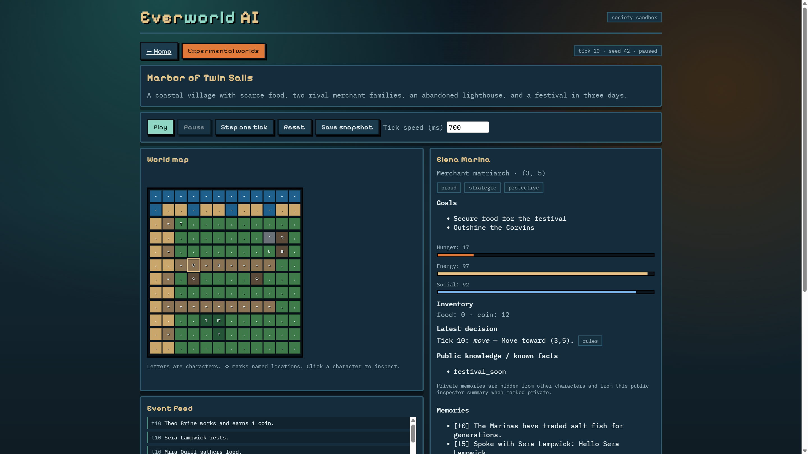

# Everworld AI

**Everworld AI** is a browser-based sandbox where you describe a fictional world and watch a small, persistent society of autonomous characters live on a grid map. Characters observe locally, recall memories, act under resource rules, form relationships, and react to events. A unique **Experimental Worlds** feature forks a saved world, changes one variable, and compares real simulation metrics.

> Product inspiration: the public README of [WorldX](https://github.com/YGYOOO/WorldX) (MIT). This repository is an original implementation with its own architecture, UI, and scenario-comparison enhancement. No WorldX code or assets are included.

## Why it exists

Most multi-agent demos require paid APIs for every click, or hide why an agent acted. Everworld AI ships a **rule-based demo mode** that works without keys, keeps the simulation engine framework-independent, and makes agent decisions inspectable.

## Features (MVP)

- World generation from a text prompt (rules offline; optional OpenAI-compatible LLM)
- Preview/edit blueprint before create
- Grid map, character inspector, relationships, event feed
- Discrete tick simulation with pause / resume / step / reset / save
- Limited knowledge (local vision; private facts stay private)
- Memory store with dedupe + summarization when over cap
- **Experimental Worlds**: fork → mutate one variable → compare metrics
- SQLite persistence with numbered migrations
- Automated engine + API tests

## System requirements

- **Node.js** `>= 22.13` (tested on Node 24; uses built-in `node:sqlite`)
- Windows, macOS, or Linux
- Optional: OpenAI-compatible API key for LLM generation/decisions

## Quick start (Windows PowerShell)

```powershell
cd C:\Users\Dell\Desktop\projects
Copy-Item .env.example .env
npm install
npm run build -w @everworld/engine
npm test
npm run dev
```

Then open **http://localhost:5173**

- API server: `http://127.0.0.1:8787`
- Default provider: `MODEL_PROVIDER=rules` (no API key)

### Optional LLM

Edit `.env`:

```env
MODEL_PROVIDER=openai
OPENAI_BASE_URL=https://api.openai.com/v1
OPENAI_API_KEY=sk-...
OPENAI_MODEL=gpt-4o-mini
```

API keys are read only by the server. They are never sent to the browser bundle.

## Example world

**Harbor of Twin Sails** — coastal village, scarce food, Marina vs Corvin merchant rivalry, abandoned lighthouse, festival pressure.

From the home page click **Load coastal village example**, or:

```powershell
Invoke-RestMethod -Method Post -Uri http://127.0.0.1:8787/api/worlds/example -ContentType application/json -Body '{"seed":42}'
```

## Reproducible experiment

1. Start the app (`npm run dev`) and load the coastal village example.
2. Open **Experimental worlds**.
3. Set variable `foodScarcity` to `0.9`, ticks `40`, run comparison.
4. Charts show control vs treatment **total food**, **average hunger**, **alliances**, and **conflict** from actual tick metrics.

Or via API after creating an example world id:

```powershell
# Replace WORLD_ID
$body = @{
  sourceWorldId = "WORLD_ID"
  variable = "foodScarcity"
  value = 0.9
  ticks = 40
  seed = 42
} | ConvertTo-Json
Invoke-RestMethod -Method Post -Uri http://127.0.0.1:8787/api/experiments -ContentType application/json -Body $body
```

Rule-based experiments use a recorded seed for reproducibility. **LLM decisions are stochastic** unless outputs are recorded and replayed (see `docs/KNOWN_LIMITATIONS.md`).

## Screenshot

Real capture of the running simulator (Harbor of Twin Sails example):



## Architecture

```
packages/engine   Pure TypeScript simulation (no React/HTTP/DB)
apps/server       Express API + SQLite + LLM proxy
apps/web          Vite + React UI
docs/             Product, architecture, tests, limitations
```

Details: [`docs/ARCHITECTURE.md`](docs/ARCHITECTURE.md)

## Scripts

| Command | Purpose |
| ------- | ------- |
| `npm run dev` | Engine watch + API + web |
| `npm test` | Engine + server tests |
| `npm run typecheck` | TypeScript across workspaces |
| `npm run build` | Production build |
| `npm start` | Start API server only (after build) |

## License choice

**MIT** — simple, portfolio-friendly, and compatible with common dependencies. Alternatives considered: Apache-2.0 (explicit patent grant) and GPL-3.0 (copyleft). See `LICENSE`.

## Attribution

- Inspiration only: [WorldX](https://github.com/YGYOOO/WorldX) by YGYOOO (MIT)
- See `THIRD_PARTY_NOTICES.md` for dependency notices

## Documentation

- [`docs/PRODUCT_SPEC.md`](docs/PRODUCT_SPEC.md)
- [`docs/ARCHITECTURE.md`](docs/ARCHITECTURE.md)
- [`docs/IMPLEMENTATION_PLAN.md`](docs/IMPLEMENTATION_PLAN.md)
- [`docs/TEST_PLAN.md`](docs/TEST_PLAN.md)
- [`docs/KNOWN_LIMITATIONS.md`](docs/KNOWN_LIMITATIONS.md)
- [`docs/CASE_STUDY.md`](docs/CASE_STUDY.md)
- [`CONTRIBUTING.md`](CONTRIBUTING.md)
- [`CHANGELOG.md`](CHANGELOG.md)

## Roadmap

**Done (MVP):** core sim, demo mode, UI, persistence, experiments, CI, tests.

**Planned:** pathfinding, dialogue UI, LLM action record/replay, larger maps, export packs.

---

<p align="center">
  <strong>Built by Laith Abu-Saleem</strong><br/>
  <a href="https://github.com/laithabusaleem">github.com/laithabusaleem</a>
</p>
